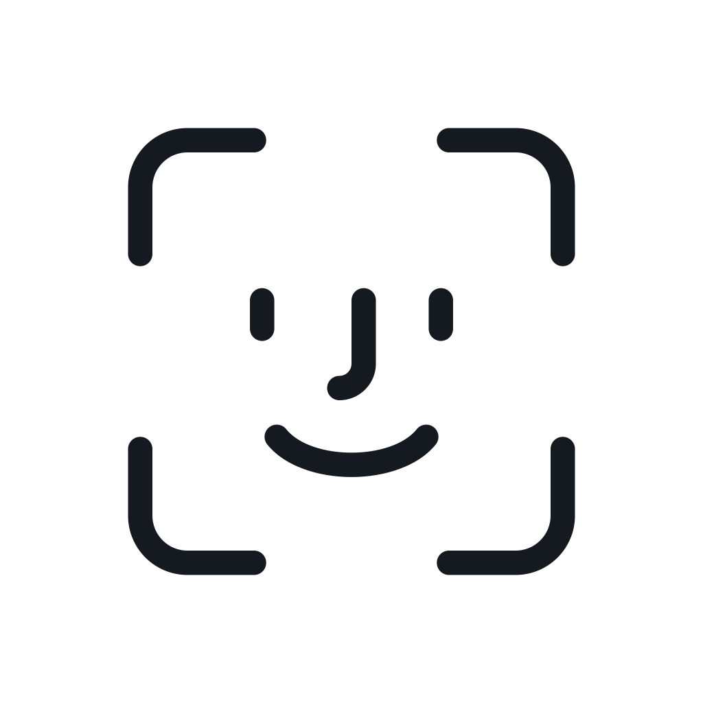

<h1 align="center">
  <br>
  
  <br>
  Sesame
  <br>
</h1>

<h3 align="center">Face unlock for your Mac</h3>

<p align="center">
  <a href="LICENSE"></a>
  
  
  <a href="https://github.com/archit-suryawanshi/Sesame/releases/latest"></a>
</p>

Open sesame. Lift the lid, look at your Mac, and it unlocks. Everything runs on-device using Apple's
Vision and Core ML frameworks, so your face data and your Mac password never touch the internet. The
UI is built into your MacBook's notch, and the app itself stays out of the menu bar and the Dock.

Sesame is a fork of **[glance](https://github.com/jonnyoo/glance)** by Jonathan Zhou. See
[what this fork changes](#what-this-fork-changes).

---

> [!WARNING]
> ## Read before downloading
> ## Sesame is not as secure as Apple's FaceID or TouchID
>
> MacBooks don't come equipped with the depth sensors that make iPhone FaceID trustworthy and secure.
> An iPhone builds a 3D map of your face; a MacBook webcam sees a flat 2D image. That means:
>
> - Sesame defeats, with reasonable confidence, a printed photo and a photo on a phone screen
> - Sesame does not reliably defeat a video of you
> - macOS has no API that lets a third-party app authorize a login, so Sesame unlocks by typing your
>   stored password on the lock screen
>
> Sesame is a convenience feature, not a security upgrade. Only continue if you accept the tradeoff.

## Installation

**Requirements:**
- macOS 15 Sequoia or later
- Apple Silicon or Intel Mac

<p align="center">
  <a href="https://github.com/archit-suryawanshi/Sesame/releases/latest/download/Sesame.dmg">
    
  </a>
</p>

<p align="center">
  <sub>Signed with Developer ID and notarized by Apple, so it opens without a Gatekeeper warning.</sub>
</p>

Open the `.dmg` and drag Sesame to `/Applications`, then open it.

## Permissions

| Permission | Why |
|---|---|
| **Camera** | To see your face. Frames are processed in memory and never written to disk. |
| **Accessibility** | To type your password into the lock screen. |
| **Touch ID** | Gates the key that encrypts your face data and password. |

## How it works

1. Launch the app and follow the onboarding to enroll your face. Sesame guides you through capturing
   your face, turning your head in nine directions. Each frame becomes a 512-number *embedding* — a
   mathematical fingerprint — and the image is thrown away.
2. Enter your Mac password once, encrypted behind Touch ID.
3. Lift the lid and the animation appears in the notch and starts searching for a face. Lock your Mac
   some other way and it waits until you ask, with right Shift.
4. If it's you — and you're looking at the screen, and the liveness checks agree you're a real
   person — Sesame types the password and you're in.

## Features

| Feature | Description |
|---|---|
| **Two lock states** | Opening the lid scans automatically. Any other lock waits for **right Shift**, so a Mac you deliberately locked isn't watched by its own camera. |
| **Attention awareness** | Your eyes have to be on the screen, not just your face pointed at it, the way Face ID means it. Estimated from pupil position, since macOS has no gaze API. |
| **Calibrated matching** | The similarity threshold is measured from your own enrollment rather than shipped as one number for everybody. Settings shows the value and what your hardest pose scored. |
| **Liveness checks** | Watches for the motion and reflections that separate a real face from a photo. *Light* or *Heavy* strictness, or off. |
| **Yields to Touch ID** | Unlock with your fingerprint or type your password and Sesame stops looking and switches the camera off immediately. It never competes with an unlock already in progress. |
| **Invisible** | No menu bar icon, no Dock tile. Settings opens with `⌃⌥⌘S`, by launching Sesame again, or with `open sesame://settings`. |
| **Notch UI** | A closed pill that expands into a scan animation with success and failure states. Hover to retry — or turn animations off entirely and Sesame stays invisible. |
| **Multiple identities** | Enroll several people, or several versions of yourself — with glasses, a beard, different lighting. Toggle any of them off without deleting. |
| **Camera & display** | Choose which camera to use, including different cameras for the built-in display vs. an external monitor. |
| **Auto-locking sessions** | The Touch ID session re-locks itself after an idle period you choose, so an unattended Mac doesn't stay authorized forever. |
| **Diagnosable** | Every gate that can decline an unlock says so by name in the unified log, with the scores it measured. |
| **Your data, your call** | Edit or delete your enrolment or stored password at any time. The encrypted files are removed immediately. |

---

# What this fork changes

The camera pipeline, the notch UI, the encrypted credential store, the liveness architecture and the
guided enrollment are all Jonathan Zhou's work, and they are good work: this fork changes a few
hundred lines out of fourteen thousand. If you want the original, go to
[glance](https://github.com/jonnyoo/glance). It is well built and clearly documented, and reading it
is what made every change here possible.

Face recognition on a webcam is tuning-heavy, and tuning that holds on one Mac in one room does not
always hold on another. This fork came out of one setup where unlocks were not landing, and each
change below was measured on the hardware in front of it rather than adjusted by feel.

| Area | What Sesame does |
|---|---|
| **Match threshold** | Measured from your own enrollment, clamped to a floor and ceiling derived from benchmark data, rather than a fixed cutoff. Decides on the mean of the three closest samples, with the centroid as a slackened sanity check instead of a second equal gate. |
| **Glare cue** | Treats specular *concentration* as a gate rather than a discount, so scattered highlights — skin — contribute nothing. A regression fixture matching a real face at a lock screen guards it. |
| **Logging** | The whole unlock path logs to `os_log` at `notice` and above, so entries persist and can be read back. |
| **Unlock result** | The result of typing the password is acted on, and the session is polled to confirm the screen really unlocked, because `CGEvent.post` cannot report being dropped. |
| **Session arming** | Asks for Touch ID once at launch, so face unlock is armed rather than silently inert after a restart. |
| **Lock screen focus** | Clicks the password field awake at the *start* of a scan, so its settling overlaps camera warm-up instead of following recognition. |
| **Latency** | The capture session starts the instant a lock or wake arrives, in parallel with the settle and arm delays, and is held briefly rather than released between the two events a wake emits. |
| **Yielding** | An unlock by any other means cancels the scan and releases the camera before the settle delay, and reports as superseded rather than as a face that failed to match. |

Full detail, with the measurements behind each one and one change that was measured and then
**reverted**, is in **[FORK.md](FORK.md)**.

---

# Privacy and Security

Sesame is designed to keep biometric data and credentials on-device.

### Face data

Sesame never stores camera images. During enrollment, each captured face is converted into a
**512-dimensional embedding** using an ArcFace-based Core ML model. The original frame is then
discarded. Embeddings are stored locally and encrypted with **AES-GCM**.

### Credentials

Your Mac password is stored as encrypted data and is never written to disk in plaintext. The
encryption key is a **256-bit AES key stored in the macOS Keychain**, protected by `userPresence` —
requiring Touch ID or your device password. The key is only held in memory while an authorized
Sesame session is active.

### Unlock pipeline

Sesame won't type your password simply because a face matches. An unlock requires all of the
following:

1. A valid Sesame session is authorized.
2. The Mac is actually at the lock screen.
3. An enabled identity matches above the calibrated similarity threshold.
4. You are looking at the screen, if attention is required.
5. Liveness checks accept the detected face.
6. Accessibility permission is available to enter the password.

Recognition, attention and liveness run independently and must all succeed before the password is
entered.

### How it tells a face from a photo

Five independent cues over a rolling ~2s window, in two roles:

- **Deny cues** are evidence of a spoof — screen glare, or a device-shaped rectangle framing the
  face. Either one fails the scan outright and overrides anything else.
- **Confirm cues** are evidence of a real face — flat-vs-3D landmark geometry, nose parallax across
  head turns, blinks. Any one is enough, and their absence is never a failure, since a live person
  can sit still and not blink.

Light detection includes only deny cues. Heavy includes both.

### Face Lab

Face Lab is a hidden debug console to test face recognition and liveness detection with real values.
**To open it:** Settings → About, then click the app icon 5 times.

## Diagnosing a failed unlock

```bash
/usr/bin/log show --predicate 'subsystem == "app.sesame.unlock"' --last 15m
```

Note the `/usr/bin/` prefix: in zsh, `log` is a shell builtin and silently does something else. Add
`log stream --level debug` while locking the screen to see per-frame similarity scores.

## Building from source

### Prerequisites

- macOS 15+
- Xcode 26+
- Your own signing team, and your Mac registered in it once. The Touch ID-gated keychain items need
  the `keychain-access-groups` entitlement and therefore a provisioning profile.

### Installation

1. Clone the repository:
   ```bash
   git clone https://github.com/archit-suryawanshi/Sesame.git
   cd Sesame
   ```
2. Open in Xcode:
   ```bash
   open Sesame.xcodeproj
   ```
3. Set `DEVELOPMENT_TEAM` to your own under Signing & Capabilities.
4. Run the project with `Cmd + R`.

### Tests

```bash
# Liveness decision model, on synthetic cue data
swiftc -O -o /tmp/liveness_selftest tools/liveness_selftest.swift Sesame/Liveness/*.swift && /tmp/liveness_selftest

# Attention geometry, on synthetic eyes
swiftc -O -o /tmp/attention_selftest tools/attention_selftest.swift \
  Sesame/AttentionDetector.swift Sesame/FaceDetector.swift Sesame/Liveness/*.swift && /tmp/attention_selftest
```

`tools/bench/README.md` covers the embedding benchmark, including where to get the labelled images.

### Releasing

```bash
tools/release.sh
```

Archives, exports with Developer ID, builds and signs a DMG, notarizes, staples and verifies.
Credentials come from a `notarytool` keychain profile, never from the repo.

## Acknowledgements

- **[glance](https://github.com/jonnyoo/glance)** by Jonathan Zhou, which this is a fork of and which
  is the great majority of this code.
- **[The Boring Notch](https://github.com/TheBoredTeam/boring.notch)** — for the notch window physics.
- **[InsightFace](https://github.com/deepinsight/insightface)** — the ArcFace model doing the
  recognition.

## License

[MIT](LICENSE) © Jonathan Zhou for the original work, © Archit Suryawanshi for the modifications.

The bundled ArcFace model (`w600k_mbf`) is **not** covered by that MIT license. It comes from
InsightFace, whose pretrained models are published for non-commercial research use only. If that
does not suit your use, delete `Sesame/Models/ArcFace.mlpackage` and rebuild it from the official
weights with `tools/convert_arcface.py`.
